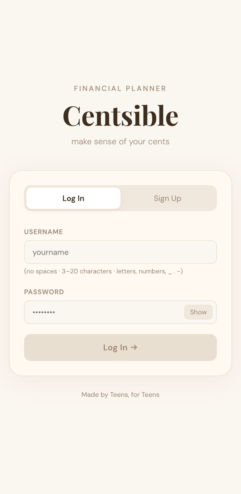
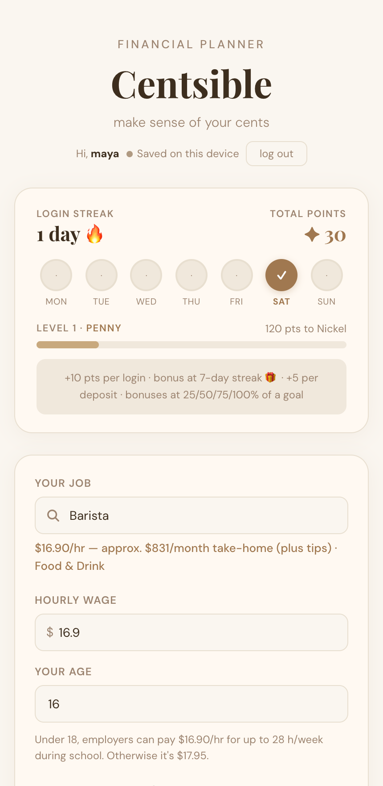
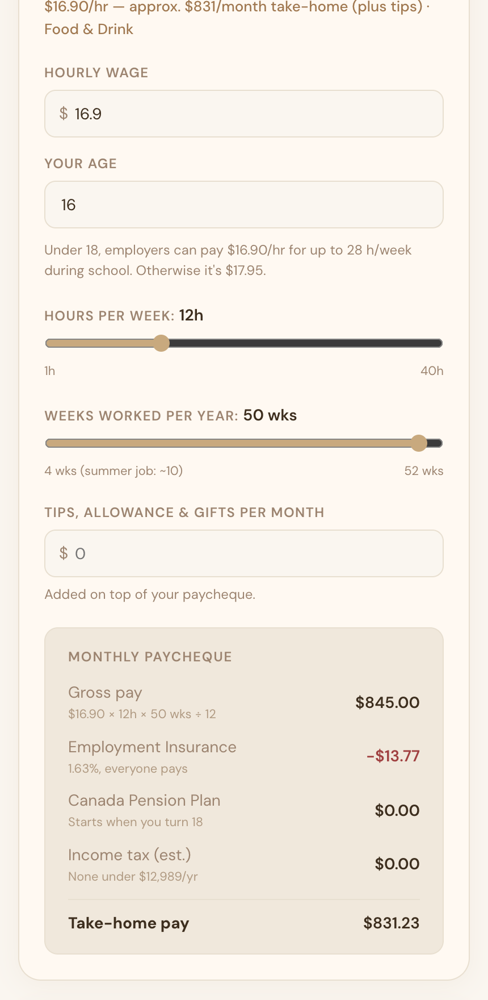
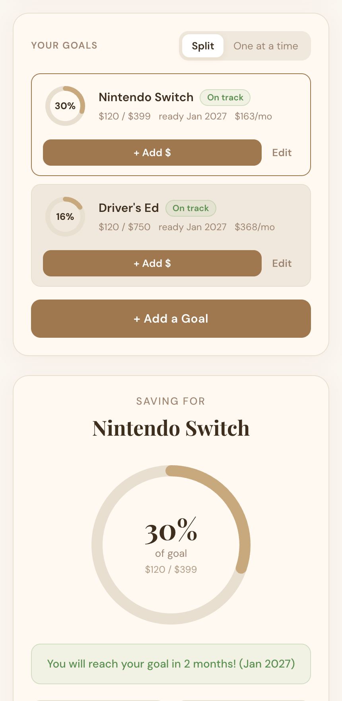
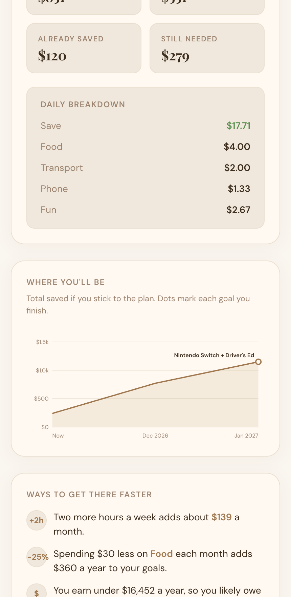
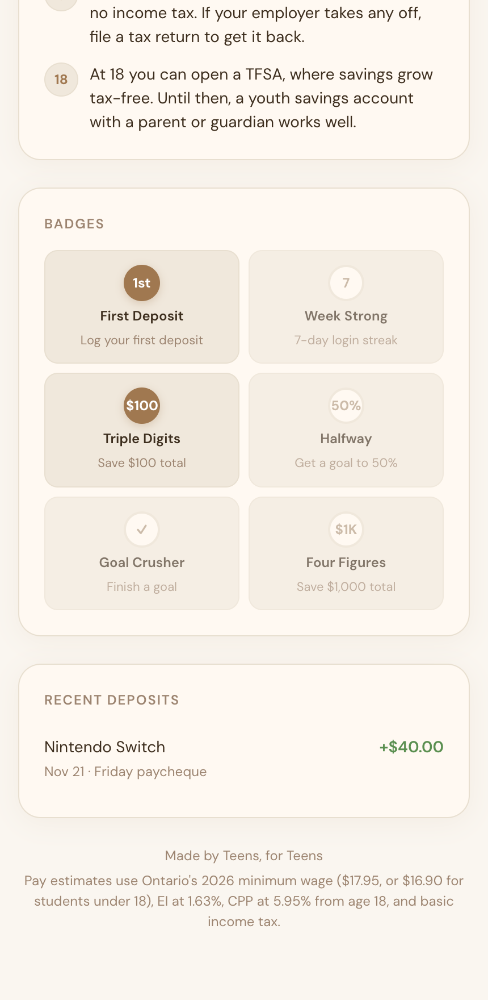

<div align="center">


# Centsible

**make sense of your cents**

A free savings planner for teens in Ontario. Pick your job, see what you'll actually take home, budget your spending, and find out exactly when you can afford the thing you're saving for.

**[centsible-ca.netlify.app](https://centsible-ca.netlify.app/)**


[](https://centsible-ca.netlify.app/)

*Made by Teens, for Teens*

</div>

---

<table>
  <tr>
    <td width="33%" align="center"><br /><sub><b>Log in or sign up</b></sub></td>
    <td width="33%" align="center"><br /><sub><b>Streaks, points and your job</b></sub></td>
    <td width="33%" align="center"><br /><sub><b>What you actually take home</b></sub></td>
  </tr>
  <tr>
    <td width="33%" align="center"><br /><sub><b>Goals that tell you when</b></sub></td>
    <td width="33%" align="center"><br /><sub><b>Projection and personal tips</b></sub></td>
    <td width="33%" align="center"><br /><sub><b>Badges and deposit log</b></sub></td>
  </tr>
</table>

## Why

Most budgeting apps are built for adults with salaries, rent and credit cards. A 16-year-old with a weekend job has different questions:

- *If I work 12 hours a week at a café, how much do I actually get?*
- *Do I even pay tax?*
- *How long until I can buy a PS5 if I stop spending so much on food?*

Centsible answers those in plain language, using real Ontario numbers.

## Features

### 💼 Paycheque estimator
- Search **180+ teen-friendly jobs** across 11 categories (Food & Drink, Retail, Sports & Rec, Tutoring, Outdoor, Animals, Tech, Creative and more), each with a typical starting wage and a tag if it usually earns tips.
- Or type any job that isn't listed and set your own wage.
- Uses Ontario's 2026 **minimum wage ($17.95)** and **student minimum wage ($16.90)** for under-18s, and warns you if a wage is below the legal minimum or if the student rate no longer applies past 28 h/week.
- A line-by-line monthly breakdown: gross pay, **EI** (1.63%), **CPP** (5.95% from age 18, above the $3,500 exemption), estimated **federal + Ontario income tax**, and the **Ontario Health Premium**.

### 🧾 Spending budget
- Editable monthly spending categories with a colour bar showing where your money goes and what's left for goals.
- Flags overspending and nudges you toward saving at least 20%.

### 🎯 Goals that tell you *when*
- Quick picks for common goals (phones, consoles, a laptop, driver's ed, a car fund, tuition), or create your own with a price and a target month.
- Two ways to split savings:
  - **Split**: each goal gets a share weighted by how much it needs and how soon it's due.
  - **One at a time**: fill the top goal first, then move on (reorder with ↑).
- Each goal shows **On track**, **N months late**, or **Not reachable yet**, plus its finish month and monthly allocation.
- A projection chart of your total savings with a dot for each goal you finish.

### 💡 Personal tips
"What if" suggestions calculated from *your* plan, like *"Two more hours a week gets you your Nintendo Switch 1 month sooner"* or *"Spend $30 less on Food and Driver's Ed arrives 2 months earlier."* Also tells you when you likely owe no tax (file a return to get it back) and when you can open a TFSA.

### 🔥 Streaks, points and badges
- +10 points per daily login, +50 at every 7-day streak, +5 per deposit, and bonuses when a goal hits 25 / 50 / 75 / 100%.
- Seven coin levels: Penny → Nickel → Dime → Quarter → Loonie → Toonie → Gold Maple.
- Six badges, from *First Deposit* to *Four Figures*.
- A deposit log so you can track every dollar you set aside.

## Privacy

Centsible has **no server and no database**. Everything you enter stays in your own browser's `localStorage`:

- Accounts are **local profiles**, so several people can share one device. Passwords are never stored; only a salted **PBKDF2-SHA256** hash (120,000 iterations, via the Web Crypto API) is kept.
- Nothing is sent anywhere, and there are no analytics or trackers.
- This also means your plan is tied to the browser you made it in. Clearing site data removes it, and it won't sync to another device.

## How the math works

All money math lives in [`src/lib/money.js`](src/lib/money.js) and is covered by unit tests.

| Step | Formula |
|---|---|
| Annual gross | `wage × hours/week × weeks/year` (hours capped at 60, weeks at 52) |
| EI | `gross × 1.63%` |
| CPP (18+) | `max(0, gross − $3,500) × 5.95%` |
| Federal tax | `max(0, gross − $16,452) × 14%` |
| Ontario tax | `max(0, gross − $12,989) × 5.05%` |
| Health premium | 6% of income over $20k (max $300), then 25% over $36k (max $450) |
| Monthly savings | `(take-home ÷ 12) + tips/allowance − spending` |

**Goal projection** (`simulate`) steps month by month for up to 10 years. In *Split* mode, each unfinished goal's weight is `remaining ÷ months left until its deadline` (12 if there's no deadline), and money left over when a goal fills up is re-split in the same month.

> These are estimates for planning, not tax or financial advice. Real payroll deductions depend on your pay period, tax credits and employer.

## Tech stack

- **React 19** with hooks, no state library
- **Vite** for dev and builds
- **Vitest** for unit tests
- Hand-written CSS and SVG charts, with no UI or chart libraries
- Hosted on **Netlify**

## Getting started

Requires Node 20+.

```bash
git clone https://github.com/Krishiv-Vaid/centsible.git
cd centsible
npm install
npm run dev        # http://localhost:5173
```

| Command | What it does |
|---|---|
| `npm run dev` | Start the dev server with hot reload |
| `npm test` | Run the unit tests once |
| `npm run test:watch` | Re-run tests on save |
| `npm run build` | Production build into `dist/` |
| `npm run preview` | Serve the production build locally |

## Project structure

```
src/
├── main.jsx               # Entry point
├── App.jsx                # Accounts, session, saving, toasts
├── styles.css             # All styles (one warm theme)
├── components/
│   ├── LoginPage.jsx      # Log in / sign up with live validation
│   ├── Planner.jsx        # Main dashboard layout
│   ├── StreakWidget.jsx   # Streak week, points, level bar
│   ├── JobCard.jsx        # Job search + paycheque breakdown
│   ├── SpendingCard.jsx   # Monthly spending categories
│   ├── GoalsCard.jsx      # Goal list, split/order toggle
│   ├── ResultsCard.jsx    # Progress ring + "will I make it?"
│   ├── ChartCard.jsx      # SVG savings projection
│   ├── TipsCard.jsx       # Personalised what-if tips
│   ├── HistoryCards.jsx   # Badges + recent deposits
│   ├── Modals.jsx         # Add/edit goal, add deposit
│   └── ui.jsx             # Shared bits: Modal, Toast, NumInput…
└── lib/
    ├── constants.js       # Ontario 2026 rates, levels, badges
    ├── jobs.js            # Job catalog
    ├── money.js           # Paycheque + goal simulation
    ├── rewards.js         # Points, streaks, badges, milestones
    ├── storage.js         # localStorage + password hashing
    ├── validation.jsx     # Username/password rules
    ├── format.js          # Currency + date helpers
    └── *.test.js(x)       # Unit tests
```

## Deploying

The repo includes a [`netlify.toml`](netlify.toml), so connecting it to Netlify needs no extra setup (build command `npm run build`, publish directory `dist`). Every push to `main` then redeploys the live site, and GitHub Actions runs the tests and build on every push and pull request.

## Updating the numbers

Wage and tax rates change every year. To update them, edit [`src/lib/constants.js`](src/lib/constants.js) and the matching expectations in [`src/lib/money.test.js`](src/lib/money.test.js), then update the footer text in `Planner.jsx`.

## License

[MIT](LICENSE)
